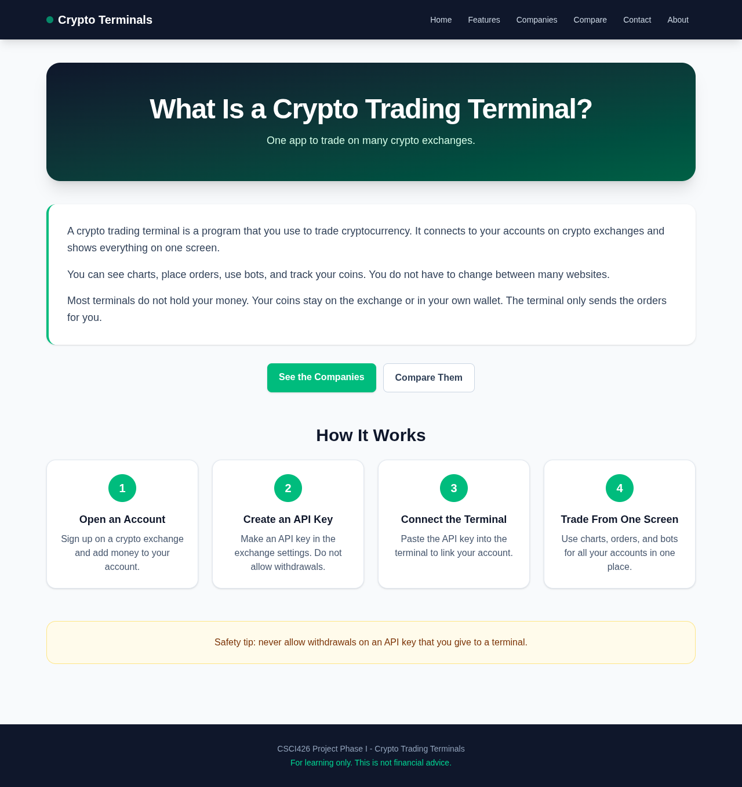
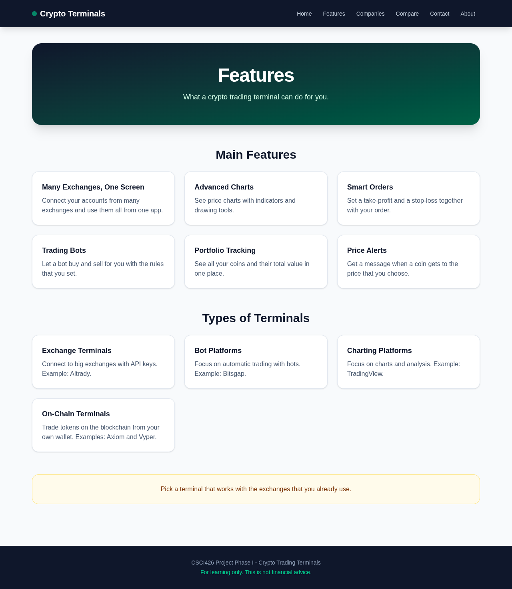
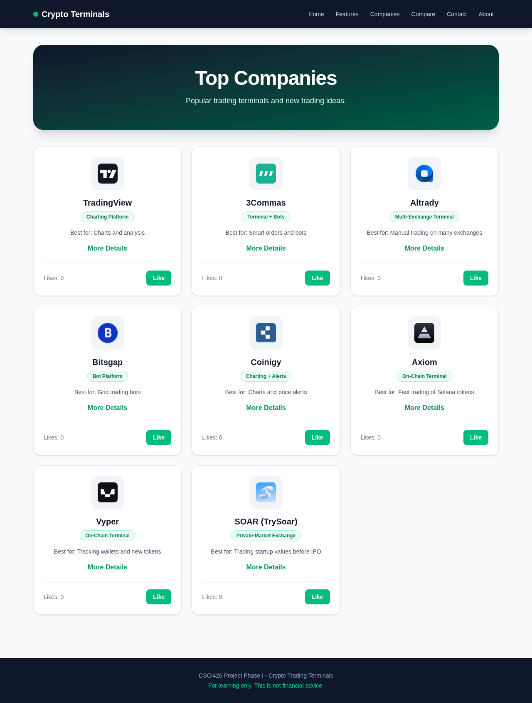
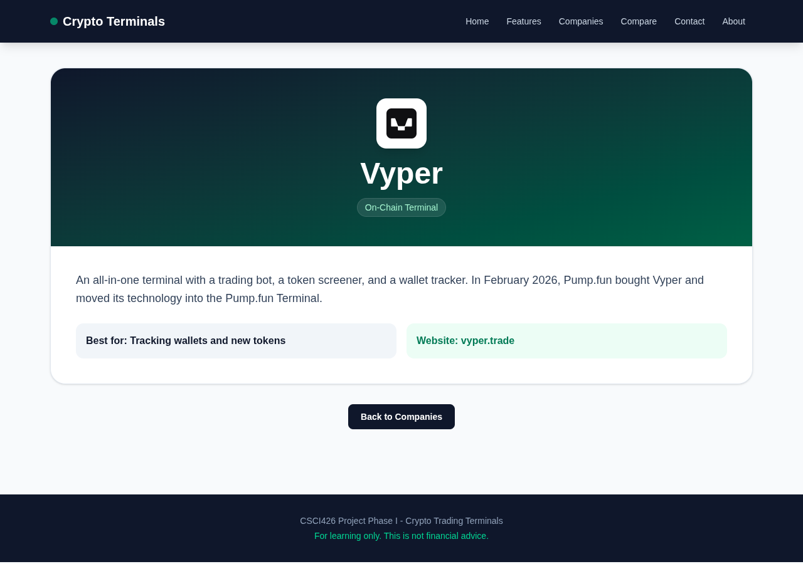
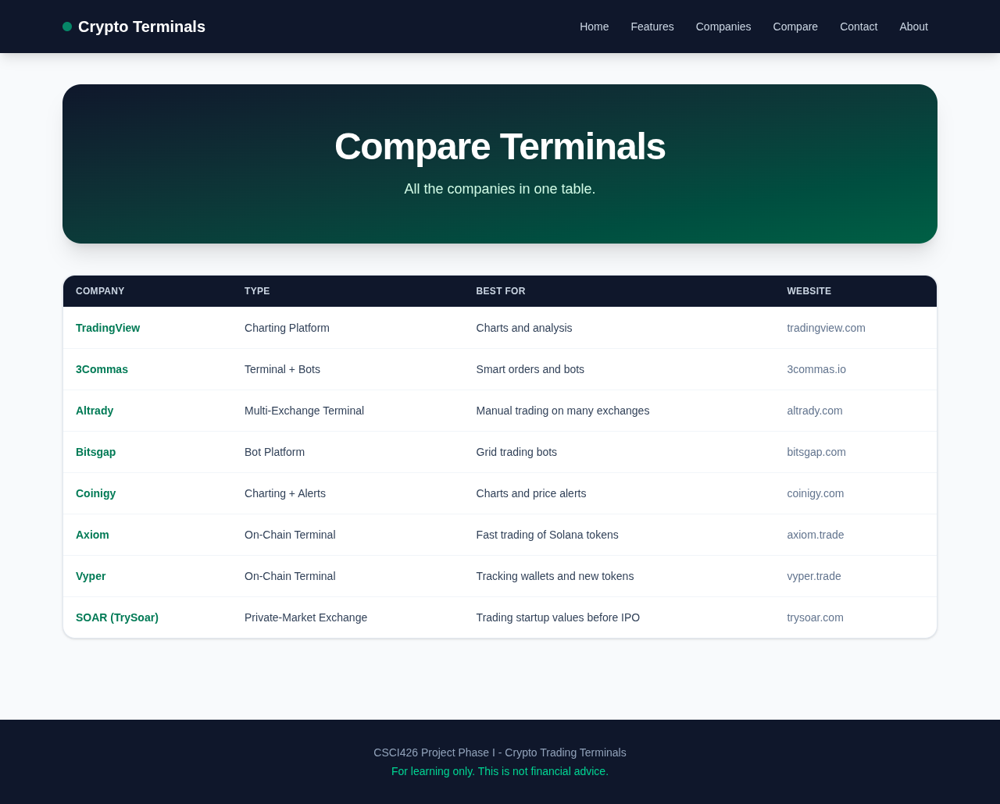
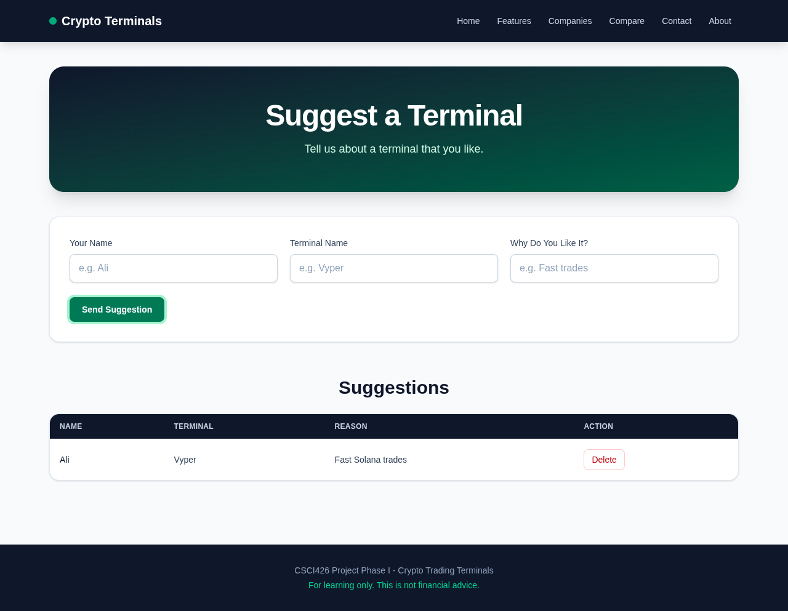
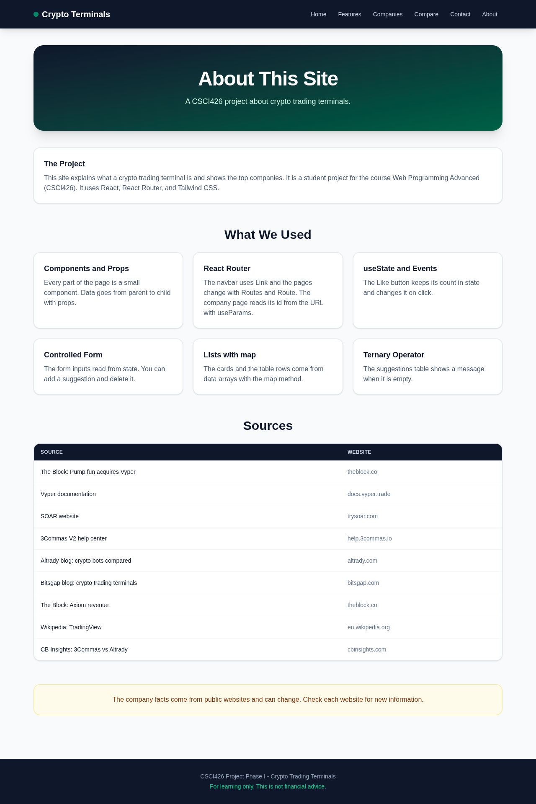
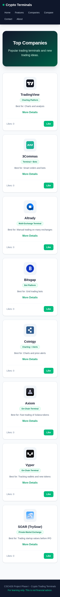

# Crypto Trading Terminals

CSCI426 Project Phase I. A small React site that explains what a crypto trading terminal is and shows the top companies, including Vyper and SOAR (TrySoar).

- Live site: https://taha-daboussi.github.io/crypto-terminals/
- Repository: https://github.com/Taha-daboussi/crypto-terminals



## Run

You need Node.js 20.19 or newer.

```bash
npm install
npm run dev
```

Open the URL that Vite prints (http://localhost:5173/crypto-terminals/).

Other commands:

```bash
npm run lint      # oxlint
npm run build     # production build in dist/
npm run preview   # serve the production build
```

## Deploy

Every push to `main` runs `.github/workflows/deploy.yml`. The workflow lints, builds, copies `index.html` to `404.html`, and deploys `dist/` to GitHub Pages.

- `vite.config.js` sets `base: "/crypto-terminals/"`.
- `App.jsx` gives the router the same base with `basename="/crypto-terminals/"`.
- `404.html` lets GitHub Pages open deep links such as `/crypto-terminals/Companies/7`.

## Pages

- **Home**: what a terminal is and how it works.
- **Features**: the main features and the types of terminals.
- **Companies**: a card for each company, with a Like counter and a link to its detail page.
- **Company detail** (`/Companies/:id`): the full description of one company. It reads the id from the URL with `useParams`.
- **Compare**: all the companies in one table. Each name links to its detail page.
- **Contact**: a form to suggest a terminal. All fields are required. Suggestions show in a table and you can delete them.
- **About**: what the site is, the course topics it uses, and the sources.

## Screenshots

| Features                                   | Companies                                    |
| ------------------------------------------ | -------------------------------------------- |
|  |  |

| Company detail                                         | Compare                                  |
| ------------------------------------------------------ | ---------------------------------------- |
|  |  |

| Contact                                  | About                                |
| ---------------------------------------- | ------------------------------------ |
|  |  |

Phone width (375 px):



## Course Topics Used

- Components and props, with many small components.
- React Router: `Routes`, `Route`, `Link`, and `useParams`.
- `useState` and events (Like click, form submit, delete click).
- A controlled form with required fields.
- Lists with `map` and `filter`.
- The ternary operator (empty table row, company not found).
- Tailwind CSS responsive grids (`grid-cols-1 sm:grid-cols-2 lg:grid-cols-3`), so the pages work on a phone.

## Design

The site uses Tailwind CSS 4, set up the same way as the course lab: the `@tailwindcss/vite` plugin in `vite.config.js` and `@import "tailwindcss";` in `src/index.css`.

- Dark slate for the navbar, the page banners, and the table headers, so the site looks like a trading screen.
- Emerald green (the "price up" color) for buttons and links. Amber for tips.
- Cards lift a little when you move the mouse over them. The dot next to the site name pulses like a live market light.
- Grids show 1 column on a phone, 2 on a tablet, and 3 or 4 on a desktop.
- The form has labels linked to the inputs and placeholder examples.

## Structure

```
src/
  main.jsx         entry point
  App.jsx          router, navbar, footer
  pages/           Home, Features, Companies, CompanyDetail, Compare, Contact, About
  components/      small reusable components
  data/            companies, features, types, steps, topics, sources
```

## AI Use

I used Claude Code (an AI coding assistant) to help write and test this project. Every commit in this repository has a `Co-Authored-By: Claude` line.

Built with Vite, React, React Router, and Tailwind CSS.
